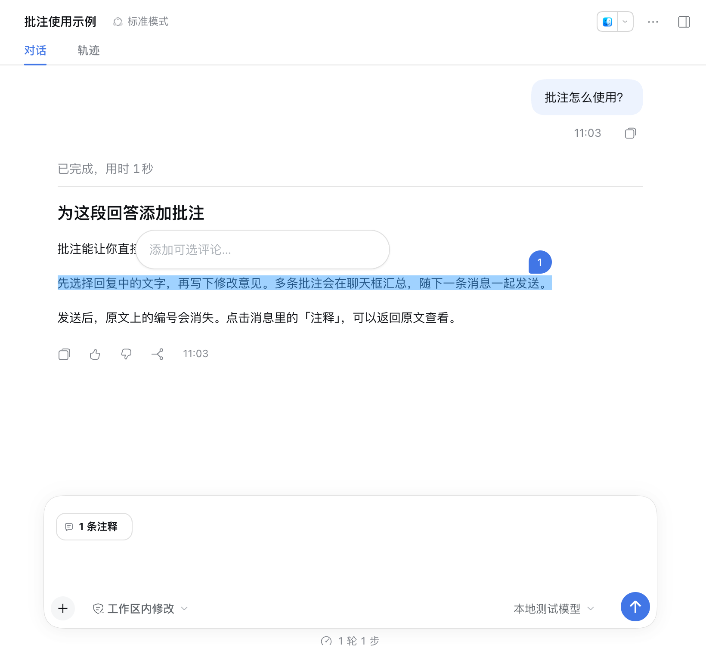
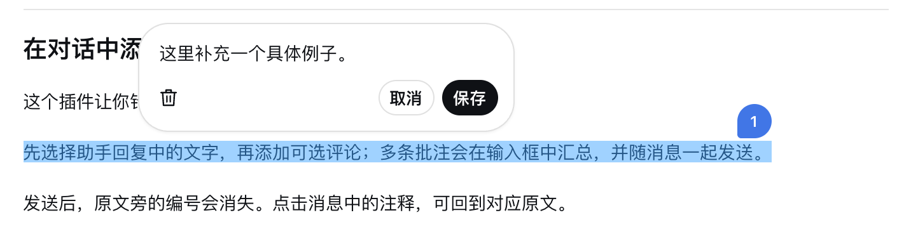
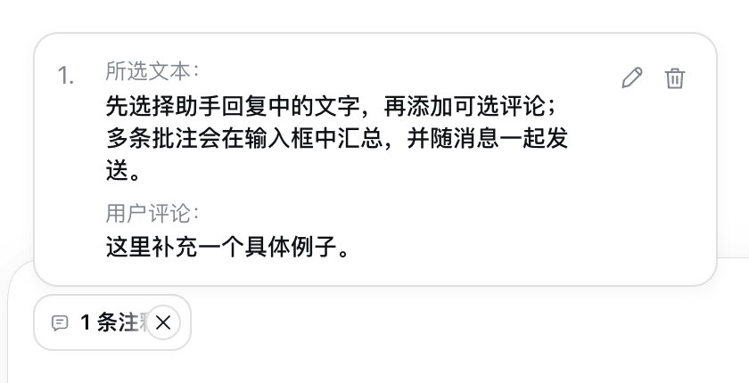
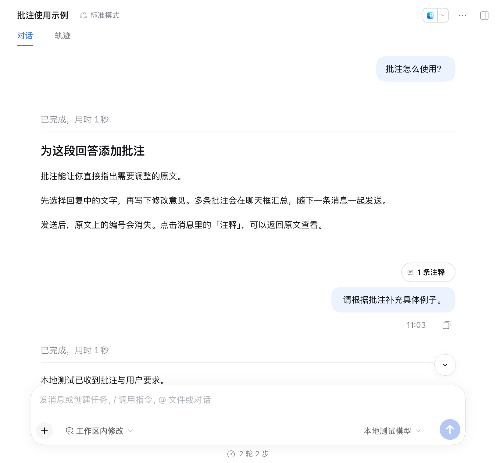
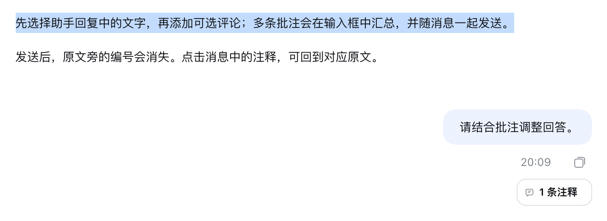

<div align="center">


# DSH Codex Annotations

**选中原文，写下评论，随消息一起发送。**

为 [DeepSeek Harness](https://github.com/deepseek-ai/deepseek-harness) 带来 Codex 风格的原文批注体验。

[](package.json)
[](docs/COMPATIBILITY.md)
[](LICENSE)

[功能](#功能) · [安装](#安装) · [使用](#使用) · [界面预览](#界面预览) · [开发](#开发) · [反馈与贡献](#反馈与贡献)

</div>

<p align="center">
  <a href="docs/assets/readme-add.png"></a>
</p>
<p align="center"><sub>原文选区、编号锚点与评论输入，保留完整的对话上下文。</sub></p>

## 功能

审阅长回复、逐段提出修改意见时，直接在对应原文上添加批注，再把多条意见一次发送给助手。

| 功能 | 体验 |
| --- | --- |
| **选区批注** | 选择助手回复中的文字，添加可选评论，原文旁显示蓝色编号。 |
| **多条汇总** | 在输入框中统一查看、编辑和删除待发送批注。 |
| **原生发送** | 随下一条消息发送，也可以只发送批注，沿用 DSH 的发送按钮与快捷键。 |
| **原文回跳** | 批注按会话保存；发送后仍可点击引用，返回并高亮对应原文。 |

## 安装

支持 **DSH Desktop / Web**，已在 **DSH 0.2.1-rc.2** 验证。安装后在插件列表中显示为 **「原文批注」**。

打开 DSH 的 **插件 → 添加插件**，输入以下来源，安装并启用：

```text
github:deepseek-harness-plugins/dsh-codex-annotations#main
```

<details>
<summary>使用命令行安装</summary>

桌面端：

```sh
dsh plugin --profile desktop add 'github:deepseek-harness-plugins/dsh-codex-annotations#main'
```

Web 端将 `desktop` 换成 `web`。macOS 未配置 `dsh` 命令时，可使用应用附带的 CLI：

```sh
'/Applications/DeepSeek Harness.app/Contents/Resources/runtime/cli/bin/dsh' plugin --profile desktop add 'github:deepseek-harness-plugins/dsh-codex-annotations#main'
```

</details>

**升级：** 在插件详情中卸载旧版，再安装新版；已保存的会话批注会保留。版本兼容与验证范围见 [兼容性说明](docs/COMPATIBILITY.md)。

## 使用

1. **选择原文** — 选中助手回复中的文字，点击「添加到对话」。
2. **添加评论** — 写下修改意见，也可以留空；点击「保存」或按 <kbd>Enter</kbd> 保存，<kbd>Shift</kbd> + <kbd>Enter</kbd> 换行。
3. **发送批注** — 继续添加其他批注，在聊天框输入要求，然后使用原生发送按钮或 <kbd>Enter</kbd> 发送。

| 操作 | 效果 |
| --- | --- |
| 悬停输入框中的「N 条注释」 | 查看完整原文，编辑或删除单条批注。 |
| 点击批注中的原文 | 跳转到对应回复。 |
| 点击批注入口旁的 × | 清空全部待发送批注。 |
| 点击已发送消息上方的批注入口 | 查看历史批注，点击原文后跳转并高亮选区；点击别处取消高亮。 |

发送给模型的内容包含 **批注编号、完整原文和评论**。用于回跳的定位信息保存在会话中。

## 界面预览

以下截图采集自 **0.2.10 实际界面**，均为 2 倍像素图片，点击可查看原图。

### 发送前：编辑与汇总

<table>
  <tr>
    <th width="50%">在原文旁编辑评论</th>
    <th width="50%">在输入框汇总批注</th>
  </tr>
  <tr>
    <td><a href="docs/assets/readme-edit.png"></a></td>
    <td><a href="docs/assets/readme-list.png"></a></td>
  </tr>
</table>

### 发送后：查看与回跳

<table>
  <tr>
    <th width="50%">批注随消息一起发送</th>
    <th width="50%">回到原文查看选区</th>
  </tr>
  <tr>
    <td><a href="docs/assets/readme-sent-message.png"></a></td>
    <td><a href="docs/assets/readme-sent.png"></a></td>
  </tr>
</table>

<details>
<summary>查看「仅发送批注」效果</summary>

聊天框留空时，也可以直接发送已保存的批注。

<p align="center">
  <a href="docs/assets/readme-annotation-only.png"></a>
</p>

</details>

## 开发

需要 **Node.js ≥ 22.19.0**。克隆仓库后安装依赖：

```sh
git clone https://github.com/deepseek-harness-plugins/dsh-codex-annotations.git
cd dsh-codex-annotations
npm ci
```

| 命令 | 用途 |
| --- | --- |
| `npm run build` | 构建插件。 |
| `npm run check` | 构建并运行单元测试。 |
| `npm run test:host` | 在隔离的 DSH 宿主中验证选区、批注、发送与回跳。 |
| `npm run screenshots` | 在隔离宿主中重现操作流程，更新 README 的六张截图。 |

宿主测试与截图脚本需要已安装的 DSH CLI 和 Chrome，使用隔离配置与本地测试模型。可通过 `DCA_CLI` 指定 CLI 路径、`DCA_BROWSER` 指定 Playwright 浏览器通道。

更多实现与验证细节：[兼容性说明](docs/COMPATIBILITY.md) · [验证记录](docs/verification.md) · [UI 对照](docs/ui-comparison.md)。

## 反馈与贡献

欢迎通过 [Issue](https://github.com/deepseek-harness-plugins/dsh-codex-annotations/issues) 反馈问题或提出建议，也欢迎提交 [Pull Request](https://github.com/deepseek-harness-plugins/dsh-codex-annotations/pulls)。反馈界面问题时，请附上 DSH 与插件版本、复现步骤和截图。

行为变更请补充相应测试。提交信息遵循 [Conventional Commits](https://www.conventionalcommits.org/zh-hans/v1.0.0/)，维护约定见 [AGENTS.md](AGENTS.md)。

## 许可证

[MIT](LICENSE)
